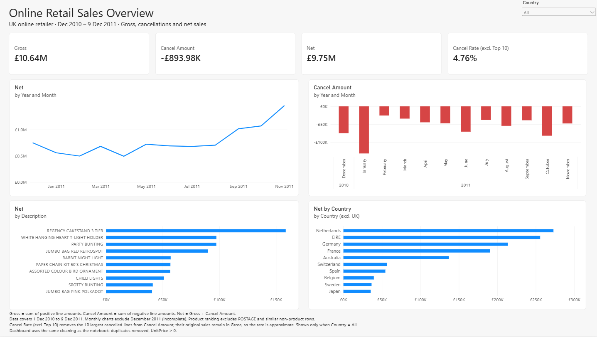
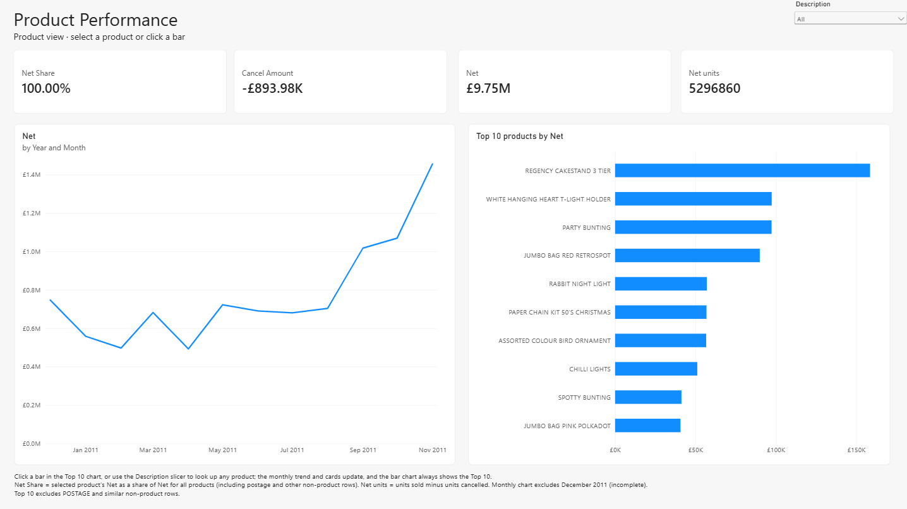

# Online Retail: How Data Cleaning Changes the Business Story

## Question

A transaction dataset can look straightforward, but not every row is a sale. This project asks: **how do the cleaning decisions change the business conclusions drawn from the data?**

## Data

[UCI Online Retail dataset](https://archive.ics.uci.edu/dataset/352/online-retail) (CC BY 4.0): 541,909 transaction lines from a UK-based online retailer, 1 Dec 2010 – 9 Dec 2011. The raw data file is not included in this repository; the Power BI file embeds a copy (see Dashboard).

## Dashboard





The Power BI report has two pages:

- **Overview:** gross, cancelled and net sales, cancellation rate, monthly trends, top products and countries.
- **Products:** click a bar in the Top 10 chart, or use the Description slicer to look up any product; the monthly trend and cards update.

It applies the same cleaning steps as the notebook (de-duplication, UnitPrice > 0), and its totals reconcile with the notebook: gross £10.64M, cancellations -£893.98K, net £9.75M, cancellation rate excluding the 10 largest cancelled lines 4.76%. Monthly charts exclude December 2011 because the data ends on 9 December.

The Power BI file (`online-retail-dashboard.pbix`) is included in this repository. It embeds the UCI dataset (CC BY 4.0), so the DAX measures and Power Query cleaning steps can be inspected directly.

## Key findings

**1. Many rows are not sales.** Cancellations, likely stock write-offs (price 0, no customer ID, descriptions such as "damaged"), two bad-debt accounting entries and zero-price lines were identified and kept out of sales. Row counts reconcile at every step (536,641 → 534,129 → 524,878). The reasons behind each group are assumptions, since the data does not state them.

**2. The cancellation rate depends on what you count.** Cancellations are ~1.7% of rows but ~8.4% of gross sales value. Ten lines make up ~43% of all cancelled value, and most of them are not ordinary returns (two very large orders, six "AMAZON FEE" lines, one manual adjustment). Without them the rate is ~4.8%.

**3. Rankings change once cancellations are deducted.** The top two products by units sold (about 159,000 units combined) were large orders that were cancelled. Using net figures they drop out of the top 10, both by units and by revenue. Postage and "Manual" lines were excluded from product rankings because they are not products.

**4. The business depends on the UK.** The UK accounts for ~84.6% of gross sales.

## Definitions

- **Gross sales:** quantity > 0 and price > 0 (524,878 rows). How much was sold.
- **Net sales:** price > 0, cancellations kept (534,129 rows). Revenue left after cancellations.
- **Net units:** units sold minus units cancelled.
- **Cancel rate (excl. top 10):** the 10 largest cancelled lines are removed from the cancelled amount; their original sales remain in gross sales, so the rate is approximate.

## Limitations

- The large cancelled orders are likely "placed and then cancelled" orders, but this was not verified against the original orders.
- The adjusted cancellation rate (~4.8%) is approximate: the original sales of those orders remain in gross sales.
- 25% of rows have no customer ID, so customer-level analysis would cover only part of the data.
- Other non-product lines (for example "Discount") were not investigated.
- 5,268 identical rows were removed on the assumption that they are duplicate entries.

## How to run

**Notebook**

1. Download `Online Retail.xlsx` from the link above.
2. Convert it once to CSV (this loads much faster than Excel):
   ```python
   import pandas as pd
   pd.read_excel("Online Retail.xlsx").to_csv("Online Retail.csv", index=False)
   ```
3. Install the requirements: `pip install pandas openpyxl`
4. Open `online-retail.ipynb` and run all cells.

**Dashboard**

Open `online-retail-dashboard.pbix` in Power BI Desktop (Windows).

## Tools

Python, pandas, Jupyter, Power BI (Power Query, DAX)
